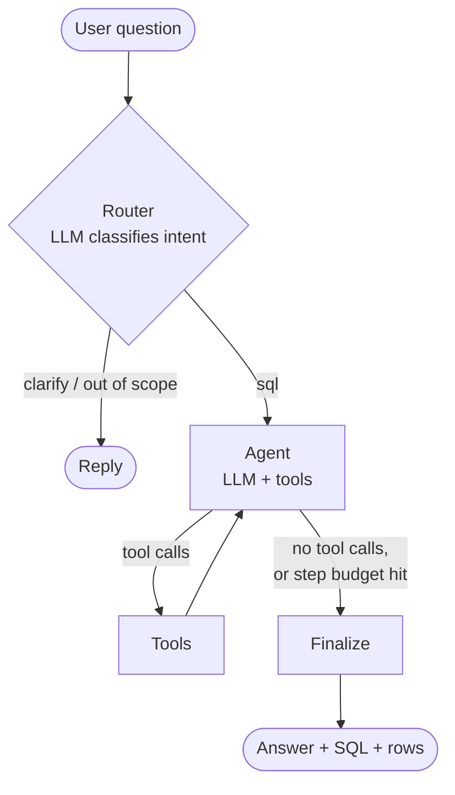
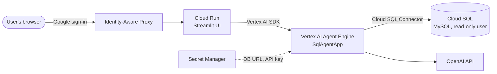

# Text-to-SQL ReAct Agent

A text-to-SQL system where the **LLM decides what to do next**. It explores the schema, looks at sample data, writes and runs queries, recovers from errors, and decides when it has enough to answer.

This is the agentic counterpart of `text-to-sql-agent`. That project is a **workflow**: the route (retrieve schema → generate → validate → execute → retry) is fixed in the graph's edges. Here, the graph only sets the boundaries:



| | Workflow (`text-to-sql-agent`) | ReAct agent (this project) |
|---|---|---|
| Which tables to look at | Vector search, fixed top-k | Agent picks: `search_schema`, `list_tables`, `describe_table` |
| Learn value formats | Not possible | Agent can call `sample_rows` |
| Error recovery | Fixed retry loop | Agent reads the error and decides how to fix it |
| Multi-step questions | One query | As many queries as it needs |
| Stopping | After execution | When the agent decides it can answer |
| Safety | Validator node in the graph | Same validator, **inside** `run_query` / `sample_rows` |
| Bound | `MAX_RETRIES` | `MAX_AGENT_STEPS` |

## Tools

| Tool | Purpose | Guardrail |
|---|---|---|
| `list_tables` | Allowed tables | `ALLOWED_TABLES` filter |
| `search_schema` | Semantic search over table schemas (Chroma) | — |
| `describe_table` | Columns, types, row count | Only allow-listed tables |
| `sample_rows` | Up to 10 real rows | Validated query, allow-list |
| `run_query` | Execute a SELECT/WITH | sqlglot validator: read-only, allow-list, no cross-DB, blocked functions, `LIMIT` cap |

Rejections and database errors go back to the model as tool results, so it can correct itself. The read-only DB session (`db/connection.py`) is the second line of defence.

## Layout

```
src/sql_agent/
├── agents/router.py          # intent gate (sql | clarify | out_of_scope)
├── agents/sql_agent.py       # agent node, step-budget routing, finalize
├── graph/workflow.py         # router -> agent <-> tools -> finalize
├── graph/state.py
├── tools/sql_tools.py        # the agent's tools + execute_sql
├── guardrails/sql_validator.py
├── prompts/templates.py
├── db/  llm/  retrieval/  utils/  config.py
├── api/main.py               # FastAPI; response includes the agent's tool-call trace
└── agent_engine.py           # SqlAgentApp: the Vertex AI Agent Engine entrypoint
scripts/ask.py                # CLI; prints each decision the agent made
scripts/ingest_schema.py      # optional: index schema for search_schema
deploy/deploy.py              # test locally, deploy and query the agent on Agent Engine
deploy/requirements.txt       # the agent's runtime dependencies (pinned)
ui/app.py                     # Streamlit web UI that calls the deployed agent
ui/Dockerfile                 # container for the UI on Cloud Run
ui/requirements.txt           # the UI's own dependencies
data/customer_insights.sql    # sample MySQL database (customers, orders, order_items, products)
```

## Getting started

```bash
python -m venv .venv
.venv\Scripts\activate
pip install -r requirements.txt
copy .env.example .env          # fill in API key + DATABASE_URL
mysql -u root -p -e "CREATE DATABASE customer_insights; USE customer_insights; SOURCE data/customer_insights.sql;"   # sample data
python scripts/ingest_schema.py # optional, enables search_schema
python scripts/ask.py "Top 5 customers by total order value"
uvicorn sql_agent.api.main:app --reload --app-dir src
pytest
```

Note: `db/connection.py` sets MySQL session options on connect (read-only transaction, `max_execution_time`), same as the original project, so point `DATABASE_URL` at MySQL.

## Deployed architecture



- **Agent Engine** runs the agent. It scales to zero when idle and starts a replica on the next request. Each replica runs several worker processes, and each worker builds its own in-memory schema index from the database at startup.
- **Cloud Run** hosts the web UI. It also scales to zero, and calls the agent as the `text-to-sql-ui` service account, which has only `roles/aiplatform.user`.
- **IAP** puts Google sign-in in front of the UI and lets in only the accounts you approve.
- **Secrets** (the database URL and the LLM API key) live in Secret Manager. Neither `.env` nor any key file is uploaded.

## Deploying to Vertex AI Agent Engine

Agent Engine builds and runs the container itself. `deploy/deploy.py` pickles `SqlAgentApp` ([src/sql_agent/agent_engine.py](src/sql_agent/agent_engine.py)), uploads it with the `sql_agent` package and installs [deploy/requirements.txt](deploy/requirements.txt). On each replica, `set_up()` rebuilds the schema index and compiles the graph, and then `query(question=...)` returns the same fields as `POST /query`.

One-time GCP setup:

1. Enable the Vertex AI, Cloud SQL Admin and Secret Manager APIs, and create a `gs://` staging bucket.
2. Move the MySQL database to Cloud SQL, and create a read-only user for it.
3. Create the secrets `sql-agent-database-url` (`mysql+pymysql://readonly_user:PASSWORD@/customer_insights`) and the LLM key: `openai-api-key` (the default provider) or `anthropic-api-key`.
4. Grant the Agent Engine service agent (`service-PROJECT_NUMBER@gcp-sa-aiplatform-re.iam.gserviceaccount.com`) these roles: `roles/cloudsql.client` and `roles/secretmanager.secretAccessor`. For `LLM_PROVIDER=vertex`, also grant `roles/aiplatform.user` and enable the Claude model in Model Garden.

```bash
pip install "google-cloud-aiplatform[agent_engines]"
gcloud auth application-default login
python deploy/deploy.py local "Top 5 customers by total order value"
python deploy/deploy.py deploy --project my-proj --bucket gs://my-proj-agent-staging \
    --cloud-sql-instance my-proj:us-central1:customer-insights   # provider/model from LLM_PROVIDER in .env
python deploy/deploy.py ask --project my-proj RESOURCE_NAME "Top 5 customers by total order value"
```

Settings used by the deployment:

- `CLOUD_SQL_INSTANCE`: when set, connections go through the Cloud SQL Python Connector, and `DATABASE_URL` only supplies the user, password and database.
- `LLM_PROVIDER=vertex` with `VERTEX_MODEL` and `VERTEX_LOCATION` calls Claude on Vertex AI with the service account instead of an API key.
- `CHROMA_PERSIST_DIR=:memory:`: each worker process keeps its own in-memory index, rebuilt on startup. A replica runs several workers, and if they share one on-disk index they collide while creating it.

Lessons from the first deployment:

- **Pin langgraph's sub-packages.** `langgraph-prebuilt` and `langgraph-checkpoint` are pinned in `deploy/requirements.txt`. Unpinned, the runtime installed a newer `langgraph-prebuilt` that doesn't work with `langgraph` 1.0.2, and `set_up()` failed with `ImportError: ExecutionInfo`. Your local run can't catch this, because your machine already has a matching pair.
- **Several workers start at once.** Anything `set_up()` writes to disk must be safe to run concurrently. `set_up()` builds the index under a file lock.
- **A failed create deletes the engine.** `--update` then returns `404`, so run `deploy` again without `--update`.
- **Each deploy replaces the engine in place** and doesn't create a revision. Deploy history is in Cloud Audit Logs (`protoPayload.methodName:"ReasoningEngine"`).

Calling the deployed agent without Python, through its REST endpoint:

```bash
curl -X POST -H "Authorization: Bearer $(gcloud auth print-access-token)" -H "Content-Type: application/json" \
  "https://REGION-aiplatform.googleapis.com/v1/projects/PROJECT_NUMBER/locations/REGION/reasoningEngines/ENGINE_ID:query" \
  -d '{"class_method": "query", "input": {"question": "Top 5 customers by total order value"}}'
```

## Web UI

[ui/app.py](ui/app.py) is a Streamlit chat page that calls the deployed agent through the Vertex AI SDK, the same way `deploy.py ask` does. For each question it shows the answer, the SQL and the result rows. The agent's resource name comes from `AGENT_ENGINE_RESOURCE`, which is read from `.env` locally or set as an environment variable on Cloud Run, or it can be pasted into the sidebar.

### Run it locally

```bash
gcloud auth application-default login   # the UI calls the agent with these credentials
streamlit run ui/app.py                 # http://localhost:8501
```

### Deploy it to Cloud Run behind IAP

One-time setup:

1. Enable the Cloud Run, Cloud Build, Artifact Registry and IAP APIs.
2. Create a service account for the UI and grant it `roles/aiplatform.user`. Grant `roles/run.builder` to the default compute service account (`PROJECT_NUMBER-compute@developer.gserviceaccount.com`), which builds the image for `--source` deploys.

Deploy. `--source ui` builds the image from [ui/Dockerfile](ui/Dockerfile) with Cloud Build, so Docker isn't needed locally:

```bash
gcloud run deploy text-to-sql-ui --source ui --region REGION \
  --service-account text-to-sql-ui@PROJECT_ID.iam.gserviceaccount.com \
  --set-env-vars AGENT_ENGINE_RESOURCE=projects/PROJECT_NUMBER/locations/REGION/reasoningEngines/ENGINE_ID \
  --no-allow-unauthenticated --memory 1Gi --cpu 1 --min-instances 0 --max-instances 2 \
  --timeout 3600 --session-affinity        # Streamlit keeps a websocket open per browser
```

To test the service while it's still private, run `gcloud run services proxy text-to-sql-ui --region REGION --port 8080` and open http://localhost:8080.

Turn on IAP:

```bash
gcloud beta services identity create --service=iap.googleapis.com --project=PROJECT_ID
gcloud run services add-iam-policy-binding text-to-sql-ui --region=REGION \
  --member=serviceAccount:service-PROJECT_NUMBER@gcp-sa-iap.iam.gserviceaccount.com --role=roles/run.invoker
gcloud beta run services update text-to-sql-ui --region=REGION --iap
```

Approve users (run `remove-iam-policy-binding` to revoke):

```bash
gcloud iap web add-iam-policy-binding --resource-type=cloud-run --service=text-to-sql-ui --region=REGION \
  --member=user:EMAIL --role=roles/iap.httpsResourceAccessor
```

**If the project belongs to an organization:** IAP's default Google-managed OAuth client only admits members of that organization, so personal Gmail accounts get "You don't have access" even when they're approved. To fix it, use your own OAuth client:

1. In Google Auth Platform, set the audience to **External**. Publish the app, or add each user under **Test users**.
2. Create a **Web application** OAuth client, with the redirect URI `https://iap.googleapis.com/v1/oauth/clientIds/CLIENT_ID:handleRedirect`.
3. Point IAP at it with `gcloud iap settings set iap_settings.yaml --project=PROJECT_ID`, where the file contains:

```yaml
access_settings:
  oauth_settings:
    client_id: CLIENT_ID
    client_secret: CLIENT_SECRET   # keep this file out of the repo; delete it after use
```

After changing the sign-in setup, test in a fresh private window. Browsers can keep an old IAP sign-in, and a stale one looks like an access error.

## Operating costs

Both services scale to zero, so the main cost while idle is **Cloud SQL**. Stop it when it isn't in use. While it's stopped, the agent returns a database error.

```bash
gcloud sql instances patch customer-insights --activation-policy=NEVER    # stop
gcloud sql instances patch customer-insights --activation-policy=ALWAYS   # start
```

| Resource | While idle |
|---|---|
| Agent Engine, Cloud Run (min 0) | No charge |
| Cloud SQL (stopped) | Storage only |
| Artifact Registry | Each UI deploy adds an image (~220 MB). Set a cleanup policy to keep the latest few. |
| Secret Manager, staging buckets | A few cents a month |

`--min-instances 1` on either service avoids cold starts, but keeps one instance billed around the clock.

## Troubleshooting

| Symptom | Likely cause |
|---|---|
| `set_up()` failed / engine failed to deploy | Read the engine's logs: Logs Explorer, resource type *Reasoning Engine*. Common causes are a missing IAM role, a wrong secret value, or a package version skew. |
| `Could not connect to tenant default_tenant` | Workers shared an on-disk Chroma index. Use `CHROMA_PERSIST_DIR=:memory:`. |
| The agent answers with a database error | Cloud SQL is stopped. |
| The first question is slow | A cold start: a replica boots and every worker rebuilds the index. |
| IAP: "You don't have access" | The user isn't approved, a stale browser sign-in, or the organization limit described above. |
| PowerShell: `gcloud.ps1 cannot be loaded` | Run `Set-ExecutionPolicy -Scope CurrentUser RemoteSigned`, or call `gcloud.cmd`. |

## Settings (new)

- `MAX_AGENT_STEPS` (default 10): the number of LLM turns before the agent is stopped.
- `TOOL_RESULT_ROWS` (default 50): rows of a query result shown to the model. The API still returns all rows, up to `MAX_ROWS`.
- `AGENT_ENGINE_RESOURCE`: the deployed agent the web UI calls (`projects/PROJECT_NUMBER/locations/REGION/reasoningEngines/ENGINE_ID`).
